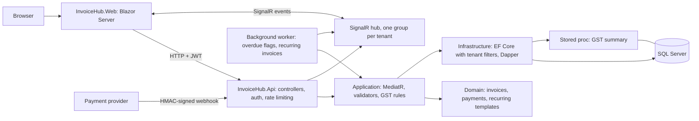
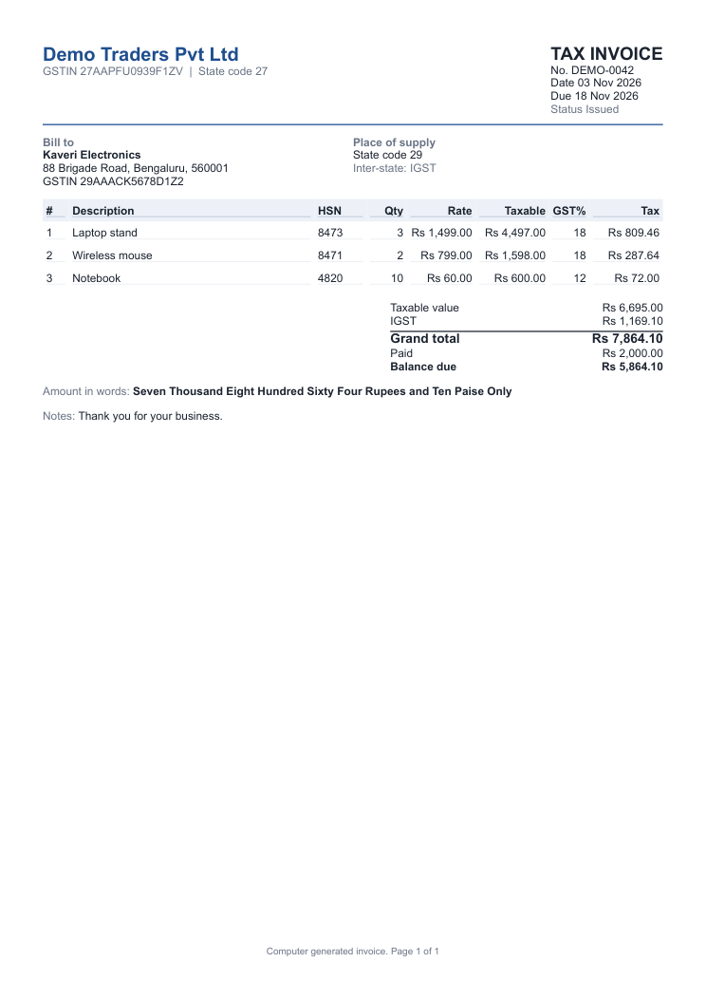
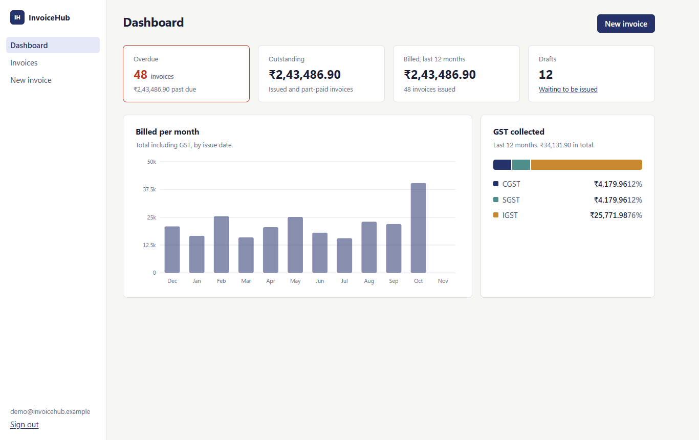
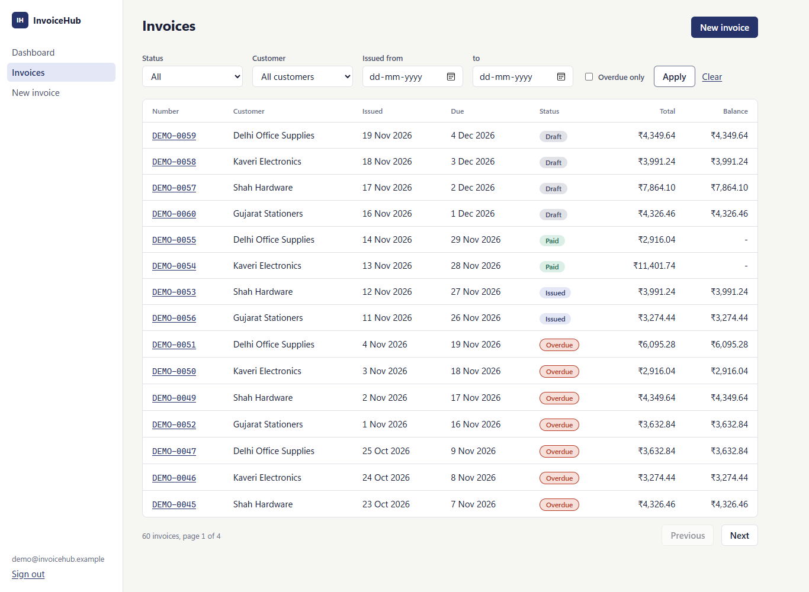
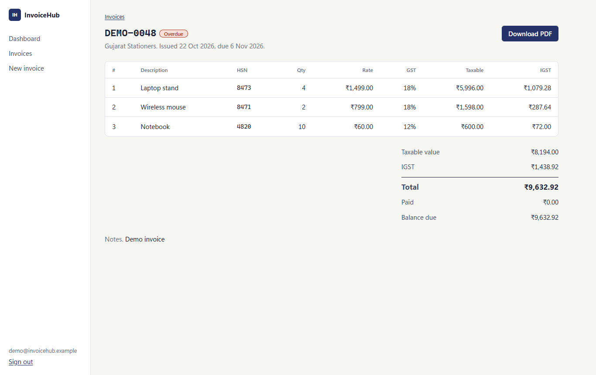
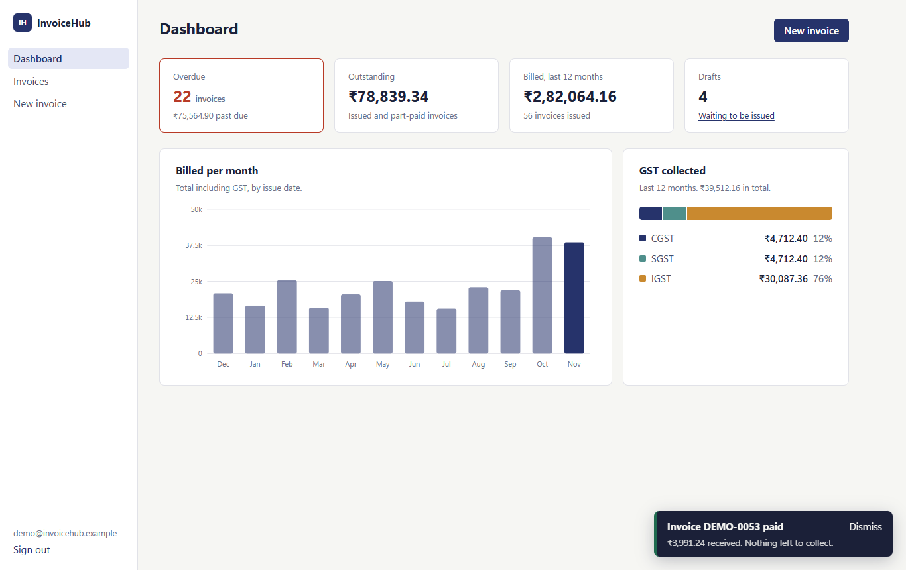

# InvoiceHub

[](https://github.com/AryaShah800/invoicehub/actions/workflows/ci.yml)

Multi-tenant GST invoicing REST API built with ASP.NET Core (.NET 8). Businesses register, add customers and products, raise GST-correct invoices (CGST + SGST within a state, IGST across states), receive payments through an HMAC-signed webhook, and get live updates over SignalR.

**Live demo: https://invoicehub-q7z9.onrender.com** (SQLite demo build on Render's free tier, see [Hosted demo](#hosted-demo)).

## Status

| Area | State |
|---|---|
| API, multi-tenancy, auth, invoices, GST, reports, payments webhook, SignalR, PDF invoices | Built and tested (`dotnet test`) |
| GitHub Actions CI ([.github/workflows/ci.yml](.github/workflows/ci.yml)) | Runs on every push and pull request to `main`: build (warnings are errors), vulnerable-package check, all unit and integration tests on `windows-latest` with LocalDB |
| Azure DevOps pipeline ([azure-pipelines.yml](azure-pipelines.yml)) | Written. Its steps were rehearsed locally. **It has not yet run on Azure DevOps** |
| Azure resources ([infra/provision.ps1](infra/provision.ps1)) | Written and syntax-checked. **Not yet run against Azure** |
| Live deployment | Public demo on Render: <https://invoicehub-q7z9.onrender.com> (see [Hosted demo](#hosted-demo)). The Azure deployment below has not been run yet |
| Web UI (Blazor Server, `src/InvoiceHub.Web`) | Built: login, dashboard, invoice list and detail, create invoice, live payment toast |
| Tests | `dotnet test` on this branch (Release, run just before this README edit): 360 passed, 1 skipped (138 unit, 167 API integration, 55 UI component tests; the 1 skipped is the browser smoke test, which runs only when `E2E_WEB_URL` is set). Unit tests use Moq and FluentAssertions, UI tests use bUnit |

## Tech stack

C# 12, .NET 8, ASP.NET Core Web API, EF Core 8, SQL Server, Dapper, MediatR, FluentValidation, SignalR, ASP.NET Core Identity with JWT, Serilog, xUnit, BenchmarkDotNet, Azure DevOps pipeline, Azure App Service and Azure SQL (deployment prepared, see below).

## Architecture

Clean Architecture: dependencies point inwards.

```
src/
  InvoiceHub.Domain          entities and business rules, no dependencies
  InvoiceHub.Application     MediatR commands and queries, validators, DTOs, abstractions
  InvoiceHub.Infrastructure  EF Core, migrations, Dapper, Identity, JWT
  InvoiceHub.Api             controllers, SignalR hub, Serilog, health checks, rate limiting
tests/
  InvoiceHub.UnitTests
  InvoiceHub.IntegrationTests   the real API against a throwaway LocalDB database
benchmarks/
  InvoiceHub.Benchmarks         100k-invoice seeder and the EF vs Dapper benchmark
infra/provision.ps1             creates the Azure resources
azure-pipelines.yml             build, test, package, deploy
```



Choices worth knowing about:

- **Multi-tenancy:** every tenant-owned entity has an EF Core global query filter on the tenant id taken from the signed-in user's token, and a save-time guard that rejects writes for another tenant. With no tenant, queries return nothing (fail closed). Another tenant's record is a 404, not a 403.
- **CQRS with MediatR:** a pipeline behavior runs the FluentValidation validators before every handler. MediatR is pinned to 12.5.0, the last release under the Apache licence (13 and later need a licence key in production).
- **`IApplicationDbContext` exposes EF `DbSet`s,** so the Application project references EF Core (without a database provider). This is a pragmatic choice over wrapping everything in repositories.
- **Money rules live in the domain,** not in controllers: GST split, rounding, payment application and invoice status changes.

## Design decisions

- **Dapper only where it was measured to help.** The GST report runs as a stored procedure through Dapper; everything else is EF Core. The benchmark (100,000 invoices) showed Dapper beating the first EF query by 29% to 45%, but an EF query rewritten to the same shape came within 3% to 5%, so the gain was mostly the query, not the library. The EF version is kept and tested to return identical rows.
- **`OverdueMarkedOn` instead of an `Overdue` status.** Whether an invoice is overdue changes with the calendar, while its status changes only through events (issue, payment, cancel). A stored `Overdue` status would be wrong at midnight until a job ran. Instead the status stays `Issued` or `PartiallyPaid`, and the worker stamps the date it first saw the invoice overdue so the SignalR event is sent once.
- **Tenant filter at the EF level, failing closed.** A global query filter plus a save-time guard means a forgotten `Where` cannot leak another tenant's data. Dapper bypasses filters, so the stored procedure takes the tenant id as a required parameter and tests check isolation.
- **Webhook auth by HMAC, not JWT,** because the caller is a payment provider with no user. Signature over the raw bytes, a timestamp window against replay, and a unique event id per tenant for idempotency.
- **Idempotent background jobs.** Recurring invoices get a deterministic number, unique per tenant, so a re-run or a second instance cannot double-bill. Job logic takes the date as an argument and is tested without the wall clock.
- **Domain owns the money rules** (GST split, rounding, payment application), so controllers and handlers cannot get them wrong.

## PDF invoices

`GET /api/invoices/{id}/pdf` returns a GST tax invoice as a PDF (seller and buyer GSTIN, HSN per line, CGST + SGST or IGST by place of supply, totals, balance due and the grand total in words using lakh/crore). Another tenant's invoice is a 404, like every other read.



[docs/sample-invoice.pdf](docs/sample-invoice.pdf) is a sample rendered from made-up data. PDFs are drawn with [QuestPDF](https://www.questpdf.com/), used under its **Community licence** (free for individuals and small organisations; `QuestPDF.Settings.License = LicenseType.Community` is set in `QuestPdfInvoiceRenderer`). It is not MIT, so check its licence terms before using this in a larger company. The rupee amounts print as "Rs" because the built-in PDF fonts have no rupee glyph.

## Web UI

A Blazor Server app (`src/InvoiceHub.Web`) that talks to the API over HTTP with the signed-in user's JWT. Screens: login, dashboard (overdue count and amount, outstanding, billed per month, GST split), invoice list with status, customer and date filters, invoice detail with PDF download, and a create-invoice form with validation. A SignalR connection to the API shows a toast the moment a payment webhook lands.

| Dashboard | Invoices |
|---|---|
|  |  |
|  |  |

Mobile layout: [docs/screenshots/dashboard-mobile.png](docs/screenshots/dashboard-mobile.png). The screenshots were taken from the compose demo in headless Edge.

Run it: `docker compose up --build`, open http://localhost:8087 and sign in with the demo login below. Browser smoke test against the running stack (uses the Edge installed on your machine):

```bash
E2E_WEB_URL=http://localhost:8087 E2E_PASSWORD='<DEMO_PASSWORD from .env>' dotnet test tests/InvoiceHub.E2E
```

## Hosted demo

**Live demo:** https://invoicehub-q7z9.onrender.com (Blazor UI, press **Use demo account**) · API with Swagger: https://invoicehub-api-3zwv.onrender.com/swagger. Free tier: both services sleep when idle, so the first visit can take a minute or two.

A free public demo is described by [render.yaml](render.yaml): two Render free-tier web services built from [Dockerfile.demo](Dockerfile.demo) (API, `invoicehub-api`) and [Dockerfile.web.demo](Dockerfile.web.demo) (Blazor UI, `invoicehub`). What it runs, and how it differs from the normal setup:

- **SQLite instead of SQL Server.** The free tier has 512 MB of RAM and SQL Server needs about 2 GB. `Database__Provider=Sqlite` builds the schema with `EnsureCreated` (the migrations are SQL Server specific). Optimistic concurrency still works: SQLite cannot generate a `rowversion`, so the app sets a fresh concurrency token on every save. The GST report runs as a plain query summed in C# instead of the `usp_GstSummaryReport` stored procedure. The default is still SQL Server; a test checks that its EF model still matches the migration snapshot.
- **Demo data.** With `Demo__Enabled=true` the API creates the demo tenant on startup if it does not exist: 4 customers, 5 products and 60 invoices over about 11 months, created through the real commands (same data as `docker/seed.sh`). The login page shows the public demo credentials and a "Use demo account" button.
- **Data resets.** The disk is ephemeral, so data is lost on every restart or redeploy. While running, the demo tenant is also wiped and reseeded every 6 hours (`Demo__ResetIntervalHours`); accounts and tenants that visitors register are deleted at that point. The demo account never locks out.
- **Cold start.** Free services sleep after a period without traffic, so the first request after that is slow while the service wakes up, and the UI needs the API awake too.
- **Secrets.** `Jwt__SigningKey` and `PaymentWebhook__Secret` are generated by Render (`generateValue`), not stored in the repository. The UI reaches the API at its public URL (`Api__BaseUrl`), because free web services cannot receive private-network traffic.

Rate limiting (10 login/register requests per minute per client address) is on; `ForwardedHeaders__Enabled=true` makes it use the address from `X-Forwarded-For`. The UI server calls the API on behalf of every visitor, so the limit applies to the UI server's address for logins made through the web UI.

## Run it with one command (Docker)

Needs Docker only (no .NET SDK, no LocalDB, works on Windows, macOS with amd64 emulation, Linux).

```bash
cp .env.example .env        # then edit the secrets if you like
docker compose up --build
```

This starts SQL Server 2022 (`mcr.microsoft.com/mssql/server:2022-latest`), the API (migrations run on start), and a one-shot `seed` service that creates demo data through the public API: 4 customers (one in the seller's state, so CGST+SGST, three in other states, so IGST), 5 products and 60 invoices over about 11 months. Most older invoices are paid through the signed webhook, some are part-paid, the rest are overdue, issued or still drafts, so the dashboard has something to show.

- Web UI: http://localhost:8087 (change with `WEB_PORT`)
- Swagger UI: http://localhost:8088/swagger (change the port with `API_PORT` in `.env`)
- Health: http://localhost:8088/health/ready
- Demo login (demo data only, set in `.env.example`): `demo@invoicehub.example` / `Demo#Pass2026`. Call `POST /api/auth/login`, paste the token into Swagger's Authorize button, then try `GET /api/reports/gst-summary?from=2025-01-01&to=2027-01-01`.

Stop and delete the data with `docker compose down -v`. Secrets come from the git-ignored `.env`; the API still refuses to start without them.

## Getting started

Prerequisites: .NET 8 SDK, SQL Server LocalDB, and the EF Core CLI (`dotnet tool install --global dotnet-ef --version 8.0.34`).

Two secrets are never committed. Each must be at least 32 characters, and the API refuses to start without them. Set them once for local development:

```bash
dotnet user-secrets set "Jwt:SigningKey" "<a long random string>" --project src/InvoiceHub.Api
dotnet user-secrets set "PaymentWebhook:Secret" "<a different long random string>" --project src/InvoiceHub.Api
```

In other environments use the environment variables `Jwt__SigningKey` and `PaymentWebhook__Secret`.

```bash
dotnet build
dotnet ef database update --project src/InvoiceHub.Infrastructure --startup-project src/InvoiceHub.Api
dotnet run --project src/InvoiceHub.Api
```

The default connection string in `src/InvoiceHub.Api/appsettings.json` points at `(localdb)\MSSQLLocalDB`. Swagger UI is served at `/swagger` in Development only. The EF tools do not need the secrets: they build the context through a design-time factory that reads `ConnectionStrings__InvoiceHub` and falls back to LocalDB.

## Configuration

| Setting | Purpose | Default |
|---|---|---|
| `ConnectionStrings:InvoiceHub` | SQL Server connection string | LocalDB |
| `Jwt:SigningKey` | HMAC key for access tokens, 32+ characters. **Secret** | none, required |
| `Jwt:Issuer`, `Jwt:Audience`, `Jwt:ExpiryMinutes` | Token settings | `InvoiceHub`, `InvoiceHub.Clients`, 60 |
| `PaymentWebhook:Secret` | Shared secret for webhook signatures, 32+ characters. **Secret** | none, required |
| `PaymentWebhook:ToleranceSeconds` | How far a webhook timestamp may be from the server clock | 300 |
| `RateLimiting:AuthPermitsPerMinute` | Register and login requests per client address per minute | 10 |
| `RateLimiting:WebhookPermitsPerMinute` | Webhook requests per client address per minute | 300 |
| `BackgroundJobs:Enabled`, `IntervalMinutes` | The overdue and recurring-invoice job: on or off and how often it wakes | `true`, 60 |
| `BusinessCalendar:UtcOffsetMinutes` | Shared business date for overdue checks, dashboard months and new invoice defaults. Set the same value in API and Web. Falls back to `BackgroundJobs:UtcOffsetMinutes` for existing deployments | 330 (India) |
| `Serilog:*` | Log levels and sinks | console plus rolling JSON file in `logs/` |
| `AllowedHosts` | Host names the app answers to | `*` (set it in production) |

## Authentication

| Endpoint | Access | Purpose |
|---|---|---|
| `POST /api/auth/register` | anonymous, rate limited | Create a business (tenant) and its first user, who becomes Admin |
| `POST /api/auth/login` | anonymous, rate limited | Exchange email and password for a JWT (account locks for 15 minutes after 5 failures) |
| `GET /api/auth/me` | any tenant user | Show who the token belongs to |
| `POST /api/users` | Admin only | Create a Staff user in the caller's own tenant |

Tokens carry `sub`, `email`, `tenant_id` and `role` claims. The tenant for every request comes from the `tenant_id` claim, and that is what the EF Core query filters use. Every endpoint requires a signed-in tenant user unless it is marked `[AllowAnonymous]`. In Swagger, use Authorize and paste the token from `/api/auth/login`.

## Customers and products

| Endpoint | Access | Purpose |
|---|---|---|
| `POST /api/customers` | any tenant user | Add a buyer. The state code decides the place of supply; a GSTIN, if given, must match the state |
| `GET /api/customers` | any tenant user | Page through your customers (`page`, `pageSize`, `search`) |
| `GET /api/customers/{id}` | any tenant user | Another tenant's customer is a 404 |
| `POST /api/products` | Admin only | Add a catalogue item with its HSN/SAC code, unit price and GST slab |
| `GET /api/products` | any tenant user | Page through the catalogue |
| `GET /api/products/{id}` | any tenant user | Another tenant's product is a 404 |

There are no update or delete endpoints yet.

## Invoices

| Endpoint | Purpose |
|---|---|
| `POST /api/invoices` | Create a draft invoice for one of your customers |
| `POST /api/invoices/{id}/issue` | Issue a draft invoice. It then cannot be edited and can receive payments |
| `GET /api/invoices` | Page through invoices, filtered by status or overdue |
| `GET /api/invoices/{id}` | Get an invoice with its lines (another tenant's invoice is a 404) |
| `GET /api/invoices/{id}/pdf` | Download the GST tax invoice as a PDF |
| `GET /api/dashboard` | Totals for the dashboard: billed, outstanding, overdue and the GST split |

An invoice line is either a **catalogue line** (`productId` plus `quantity`; price, HSN code and GST rate come from the product and cannot be overridden) or a **custom line** (`description`, `hsnCode`, `unitPrice`, `gstRate`).

Errors are returned as ProblemDetails: 400 validation, 404 not found, 409 conflict (such as a duplicate invoice number), 422 business rule violated, 429 rate limited.

### GST

The seller's state is copied from the tenant onto each invoice when it is created, and the place of supply is the customer's state.

| Seller state vs place of supply | Tax charged |
|---|---|
| Same | CGST + SGST, each half the rate |
| Different | IGST at the full rate |

Tax is rounded to 2 decimals (half away from zero) per line, and invoice totals are the sum of those rounded line amounts. The response carries `cgstAmount`, `sgstAmount`, `igstAmount` on each line and `taxableTotal`, `cgstTotal`, `sgstTotal`, `igstTotal`, `taxTotal`, `grandTotal`, `amountPaid`, `balanceDue` on the invoice. There is no whole-rupee round-off on the grand total. Valid rates are the slabs 0, 0.25, 3, 5, 12, 18 and 28 percent. Cess, reverse charge and e-invoicing are not implemented.

## Payments

`POST /api/webhooks/payments` is how a payment provider reports a payment. There is no signed-in user, so the request is authenticated by an **HMAC-SHA256 signature** instead of a JWT.

| Header | Value |
|---|---|
| `X-Payment-Timestamp` | Unix time in seconds when the request was signed |
| `X-Payment-Signature` | `sha256=` plus the lower-case hex HMAC-SHA256, keyed with the shared secret, of the text `{timestamp}.{raw request body}` |

Body: `{ "eventId": "evt_123", "invoiceId": "<guid>", "amount": 500.00, "currency": "INR", "reference": "UPI-REF" }`.

| Response | Meaning |
|---|---|
| 200 | Payment applied. A retried event also gets 200 with `"duplicate": true` and changes nothing |
| 400 | Malformed JSON or invalid field (no event id, amount not positive or with more than 2 decimals, currency not INR) |
| 401 | Missing, wrong or stale signature. The timestamp must be within 5 minutes of the server clock, so a captured request cannot be replayed later |
| 404 | Unknown invoice |
| 409 | Event id already used for another invoice, or the invoice changed at the same moment (retry) |
| 413 | Body over 64 KB |
| 422 | Not payable: draft, cancelled, already paid, or more than the balance due |
| 429 | Too many requests from one address |

How it is built:

- The signature is checked over the exact bytes received, with a constant-time comparison.
- Money is applied by `Invoice.RecordPayment`: partly paid invoices become `PartiallyPaid`, and `Paid` once the balance reaches zero. A payment cannot exceed the balance due.
- Each event id is stored with a unique index per tenant, so a duplicate delivery, even two arriving at the same moment, is applied once. Invoices also carry a row version, so simultaneous different payments cannot overwrite each other.
- With no user, the tenant comes from the invoice. The webhook looks the invoice up across tenants once, reading only its tenant id, then continues under the normal tenant filters. Any user token sent with the request is ignored.

To send a test request from PowerShell (set `$secret` and `$invoiceId` first):

```powershell
$ts = [DateTimeOffset]::UtcNow.ToUnixTimeSeconds()
$body = '{"eventId":"evt_1","invoiceId":"' + $invoiceId + '","amount":500.00,"currency":"INR"}'
$hmac = [System.Security.Cryptography.HMACSHA256]::new([Text.Encoding]::UTF8.GetBytes($secret))
$sig = 'sha256=' + (($hmac.ComputeHash([Text.Encoding]::UTF8.GetBytes("$ts.$body")) | ForEach-Object { $_.ToString('x2') }) -join '')
Invoke-RestMethod -Method Post -Uri http://localhost:<port>/api/webhooks/payments -Body $body -ContentType 'application/json' `
  -Headers @{ 'X-Payment-Timestamp' = "$ts"; 'X-Payment-Signature' = $sig }
```

There is no real payment provider behind this: the endpoint defines the contract above and is tested against it. Connecting Razorpay or similar would mean adapting their signature scheme and payload.

### Live updates (SignalR)

After a payment is saved, the API pushes a `PaymentReceived` message to every connected client of that tenant, and to nobody else. Connect to `/hubs/invoices` with the same JWT you use for the REST API (any role). Browsers cannot set headers on a WebSocket, so the token can go in the `access_token` query string, which the API accepts for the hub path only, and it is never written to the logs. A connection is closed when its token expires.

```js
const connection = new signalR.HubConnectionBuilder()
  .withUrl("/hubs/invoices", { accessTokenFactory: () => token })
  .build();
connection.on("PaymentReceived", m => console.log(m.invoiceNumber, m.amount, m.balanceDue, m.invoiceStatus));
await connection.start();
```

The message carries `invoiceId`, `invoiceNumber`, `eventId`, `amount`, `amountPaid`, `balanceDue`, `invoiceStatus` and `receivedAtUtc`. Each connection joins the group `tenant:{tenantId}` from its token's `tenant_id` claim. A failed push is logged but does not fail the webhook, because the payment is already saved.

## Background jobs

A hosted service (`InvoiceMaintenanceWorker`) wakes every `BackgroundJobs:IntervalMinutes` and, for each active tenant:

1. **Flags overdue invoices.** An issued or part-paid invoice past its due date gets `OverdueMarkedOn` set the first time the job sees it, and a SignalR `InvoiceOverdue` event goes to that tenant's connected clients. It is set once, so the same invoice is never announced twice.
2. **Raises recurring invoices.** `POST /api/recurring-invoices` stores a template (customer, products and quantities, every 1 to 12 months, first run date, optional end date, days until due). When a template's next run date has arrived, the job creates and issues one invoice per due occurrence (a template that was paused for months catches up at most 12 per run), moves the template to its next date, and sends `RecurringInvoiceGenerated`. `POST /api/recurring-invoices/{id}/pause` stops a template.

Design notes:

- **Idempotent.** Each occurrence has a deterministic invoice number (`R` + 6 hex characters of the template id + `-yyMMdd`), unique per tenant. Running the job twice, or two instances at once, cannot create the same invoice twice, and a crash between saving the invoice and moving the template forward is repaired on the next run. Templates carry a row version for the same reason.
- **Testable time.** The logic lives in `InvoiceMaintenanceService` (Application project) and takes the date as an argument. The worker, dashboard, invoice queries and new-invoice form share `IBusinessClock`, backed by `TimeProvider` and `BusinessCalendar:UtcOffsetMinutes` (with `BackgroundJobs:UtcOffsetMinutes` as a fallback). Tests can freeze time at the business midnight boundary.
- **Tenant scope without a user.** There is no signed-in user in a background service, so each unit of work gets its own DI scope with the tenant assigned first. The tenant query filters and the write guard stay in force, and a failing tenant or template is logged and skipped without stopping the rest.
- **Pluggable notifier.** `IInvoiceEventNotifier` is implemented with SignalR today. An email or SMS implementation can be added without touching the job.

## GST report

`GET /api/reports/gst-summary?from=2026-04-01&to=2026-04-30` (Admin only) returns the GST collected per slab for invoices issued in the range: invoice count, taxable value, CGST, SGST, IGST, plus totals. Draft and cancelled invoices are left out.

It is served by the `usp_GstSummaryReport` stored procedure, called with Dapper. Dapper does not apply the EF Core tenant query filters, so the procedure takes the tenant id as a required parameter and the tests check that other tenants' invoices never appear. An EF Core version of the same query is kept as a reference: the tests check that both return identical rows, and the benchmark compares them.

**Benchmark** (100,000 invoices, LocalDB, one run): the stored procedure was 29% to 45% faster than the first EF Core query, but an EF Core query written with the same shape came within 3% to 5% of it. Most of the gain came from avoiding `COUNT(DISTINCT)`, not from Dapper. Full table, method and caveats are in [benchmarks/RESULTS.md](benchmarks/RESULTS.md).

```bash
dotnet run -c Release --project benchmarks/InvoiceHub.Benchmarks -- seed    # about 90 seconds
dotnet run -c Release --project benchmarks/InvoiceHub.Benchmarks -- bench   # several minutes
```

## Observability

- **Logging:** Serilog, one structured line per request with the tenant id and user id. Logs go to the console and to a rolling JSON file in `logs/` (14 days). Request bodies, query strings, emails, tokens and webhook signatures are never logged, and tests check this.
- **Health:** `GET /health` says the process is up. `GET /health/ready` also checks the database and returns 503 if it cannot connect. Both are anonymous and return only `Healthy` or `Unhealthy`.

## Security

- Secure by default: every endpoint requires a signed-in tenant user unless it opts out with `[AllowAnonymous]`. Roles: Admin and Staff.
- Rate limiting per client address on register, login and the webhook. Behind a proxy it only sees the real client address if forwarded headers are enabled (`ASPNETCORE_FORWARDEDHEADERS_ENABLED=true`, set by the provisioning script).
- Passwords are hashed by ASP.NET Core Identity, with lockout after 5 failed attempts.
- HSTS in production. HTTPS-only, TLS 1.2 and FTP off are set on the App Service by the provisioning script.
- No secrets in the repository. The CI pipeline fails the build if a NuGet package with a known vulnerability is used.

Known limitations, for honesty:

- Access tokens last 60 minutes and cannot be revoked: deactivating a tenant or user takes effect at the next login. There are no refresh tokens.
- A GSTIN is checked for format and state only. Its checksum character and its owner are not verified, so anyone can register a well-formed GSTIN that nobody has claimed yet.
- Register and create-user tell you when an email is already used, which lets someone test whether an email has an account.
- One shared webhook secret covers all tenants, and rotating it needs a short outage.
- The SignalR hub is tested in-process (long polling and WebSockets), not against a deployed server.

## Tests

```bash
dotnet test
```

xUnit unit tests cover the domain rules, GST maths, payment rules, signature verification and validators. Integration tests host the real API with `WebApplicationFactory`, build a throwaway database on LocalDB from the real migrations and drop it afterwards, so LocalDB must be running. They cover tenant isolation, authorization, the webhook (forged, tampered, replayed and concurrent requests), the SignalR push, logging, health checks, rate limiting and HSTS.

To add a migration:

```bash
dotnet ef migrations add <Name> --project src/InvoiceHub.Infrastructure --startup-project src/InvoiceHub.Api --output-dir Persistence/Migrations
```

## CI/CD and deployment

[azure-pipelines.yml](azure-pipelines.yml) has two stages.

| Stage | Runs on | Steps |
|---|---|---|
| Build | every push and pull request | restore, build (warnings are errors), fail on vulnerable packages, run all tests with coverage, generate the idempotent migration script, publish and zip the API |
| Deploy | `main` only, after approval if you add one to the environment | apply the migration script to Azure SQL, deploy the zip to App Service, smoke test `/health/ready` |

Migrations run before the new code is deployed. The script is idempotent, and `sqlcmd` is run with `-I` because the Identity tables use filtered indexes.

### Setting it up

1. **Azure resources.** Install the Azure CLI, run `az login`, then:

   ```powershell
   $env:INVOICEHUB_SQL_ADMIN_PASSWORD = '<a strong password>'
   ./infra/provision.ps1 -Prefix <lowercase-unique-name>
   ```

   It creates a resource group, Azure SQL (Basic) and a Linux App Service plan with a .NET 8 web app, hardens it, and sets the connection string and the two secrets as App Service settings. The free F1 plan and Basic SQL (about US$5 a month from your credit) are the defaults. `az group delete --name <prefix>-rg --yes` removes everything.
2. **Azure DevOps.** Create a project and connect this GitHub repository. Add an Azure Resource Manager service connection to your subscription, an environment named `invoicehub-production` (optionally with an approval check), and a variable group `invoicehub-prod` with `azureServiceConnection`, `webAppName`, `sqlServerName`, `sqlDatabaseName`, `sqlAdminUser` and `sqlAdminPassword` (secret). The script prints the values to use.
3. **Pipeline.** Create a pipeline from `azure-pipelines.yml`. The first run on `main` migrates the database and deploys.

### What has and has not been verified

Verified on a development machine, step by step as the pipeline runs them: a Release build with 0 warnings, the vulnerability check, the migration script applied twice to an empty database, the published build running in Production mode against that database (health, registration, login, rejected webhook, JSON log file), and the app refusing to start without its secrets.

Not verified: the pipeline running on Azure DevOps, `infra/provision.ps1` against a real subscription, and the deployed site. Expect small fixes on the first real run.

## Roadmap

- [x] Solution skeleton, domain entities, first migration
- [x] Multi-tenancy with EF Core global query filters
- [x] Identity, JWT, policy-based authorization
- [x] CQRS with MediatR and FluentValidation
- [x] GST calculation (CGST/SGST vs IGST)
- [x] Dapper stored procedure for GST reports (with benchmark)
- [x] Payment webhook (HMAC) and SignalR updates
- [x] Serilog, health checks, rate limiting, HSTS
- [x] CI/CD pipeline and Azure provisioning script (written, not yet run on Azure)
- [ ] First deployment to Azure and a public URL
- [x] Unit tests with Moq and FluentAssertions
- [x] GitHub Actions CI: build and test on every push
